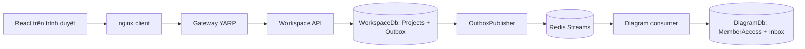
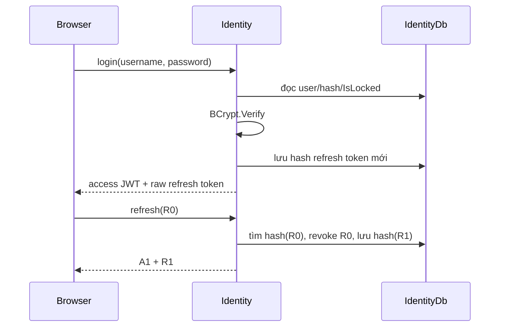
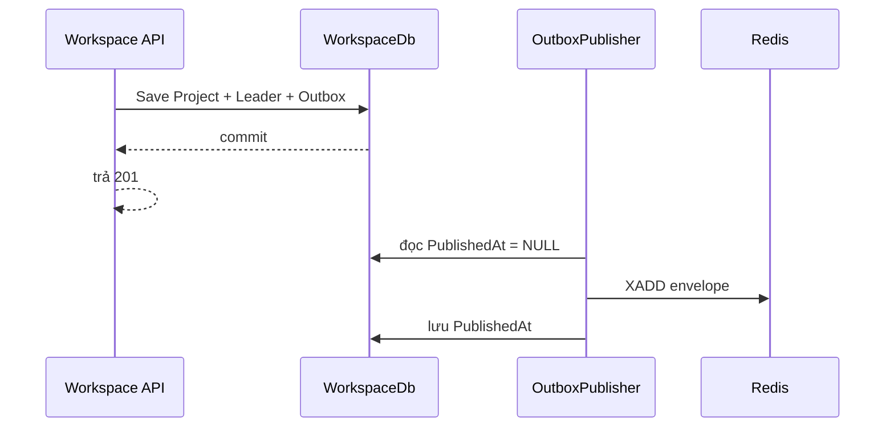
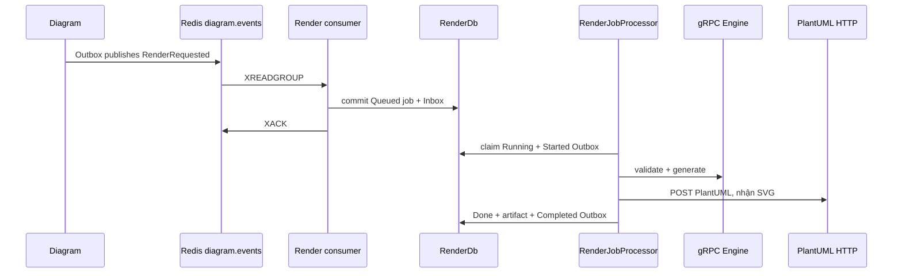

# UMLForge v2 — Sách thực hành cơ chế công nghệ và kiểm chứng

> Đọc code → dự đoán điều sẽ xảy ra → chạy một thao tác → quan sát HTTP/SQL/Redis/log → giải thích bằng bằng chứng.

**Đối tượng:** Huy và các thành viên cần hiểu, tự kiểm tra, demo và bảo vệ đồ án PRN232.
**Baseline code:** `28b4793`, sau khi đồng bộ develop. Image đang chạy có thể được build từ SHA cũ; ghi lại SHA khi làm bài.
**Cách đọc:** bắt đầu từ Identity/Workspace/Gateway của Huy, rồi lần theo sự kiện sang phần Thiện, Minh, Bảo.

Các tiêu chí/trọng số dưới đây lấy từ phần đối chiếu đề trong [PRD §10](PRD.md), [ARCHITECTURE](ARCHITECTURE.md)
và hướng dẫn dự án. Chưa coi bảng này là xác nhận chấm điểm của giảng viên hoặc thay thế PDF đề gốc.

## Mục lục

1. [Bản đồ yêu cầu và cách học](#chuong-1)
2. [Dựng phòng thực hành và bộ lệnh dùng chung](#chuong-2)
3. [Identity: JWT, BCrypt, refresh token và phân quyền](#chuong-3)
4. [REST API, ba lớp, EF Core, migration và concurrency](#chuong-4)
5. [Microservices, database riêng và Gateway YARP](#chuong-5)
6. [BackgroundService, PeriodicTimer và job chạy tay](#chuong-6)
7. [Redis Streams: event, consumer group, pending, ACK](#chuong-7)
8. [Transactional Outbox: DB đã lưu nhưng Redis chưa có](#chuong-8)
9. [Inbox/idempotency, retry, claim và DLQ](#chuong-9)
10. [gRPC/Protobuf: gọi thật unary và server streaming](#chuong-10)
11. [Render bất đồng bộ, PlantUML và worker tranh job](#chuong-11)
12. [React polling, optimistic UI và phiên đăng nhập](#chuong-12)
13. [Notification: read model và người nhận theo sự kiện](#chuong-13)
14. [Docker: image, container, DNS, healthcheck và volume](#chuong-14)
15. [Quan sát xuyên service: CorrelationId và log](#chuong-15)
16. [Unit/integration/E2E, Testcontainers và CI](#chuong-16)
17. [Kịch bản demo và bộ bằng chứng nộp thầy](#chuong-17)
18. [Câu hỏi bảo vệ và lỗi hiểu nhầm thường gặp](#chuong-18)

<a id="chuong-1"></a>
## Chương 1. Bản đồ yêu cầu và cách học

### 1.1 Thầy yêu cầu gì, trong dự án làm ở đâu?

| Tiêu chí được nhóm đối chiếu | Trọng số | Hiện thực | Bài thực hành |
|---|---:|---|---|
| Architecture & Design | 20% | Microservices, Gateway, database-per-service, event-driven | 4, 5, 7, 14 |
| REST API | 20% | Identity/Workspace/Diagram/Render/Notification; JWT, paging, validation, ProblemDetails | 3, 4, 5 |
| Background Job | 10% | BackgroundService; jobs PeriodicTimer; outbox publisher, consumers, processor | 6, 8, 11 |
| Message Broker | 15% | Redis Streams, consumer groups, Outbox/Inbox, retry/DLQ | 7, 8, 9 |
| gRPC | 15% | DiagramEngine độc lập; ba unary RPC và một server-streaming RPC | 10, 11 |
| Docker/Deployment | 10% | 11 container, multi-stage build, Compose, healthcheck, network, volume | 2, 14 |
| Documentation/Presentation | 10% | Swagger, sáu tài liệu đặc tả, traceability, bằng chứng chạy | 15, 16, 17 |

JWT, BCrypt, refresh rotation, ETag, Outbox, Inbox, polling và CorrelationId là cách nhóm hiện thực các tiêu chí;
không tự hiểu rằng mỗi kỹ thuật là một mục chấm điểm độc lập của đề.

### 1.2 Phân công khi đọc code

| Người | Phần sở hữu | Điểm nối cần hiểu |
|---|---|---|
| Huy | Identity, Workspace, Gateway; UI tài khoản/project | Ai là user, ai được vào project, sự kiện cấp quyền phát ra ở đâu |
| Thiện | Diagram, versions, Review, comments/export | Nhận quyền Workspace, gọi gRPC, phát yêu cầu render |
| Minh | Render, Notification | Nhận event, xử lý nền, trả kết quả/thông báo |
| Bảo | Contracts, BuildingBlocks, DiagramEngine, hạ tầng/CI, editor/shared | Contract và cơ chế dùng chung của toàn hệ thống |

### 1.3 Một thao tác đi qua những gì?



Ví dụ Huy tạo project: HTTP response có thể đã trả 201 trước khi Diagram cập nhật MemberAccess.
Điều cần kiểm không chỉ là “thấy project trên UI”, mà còn là DB nghiệp vụ, event và read model đã khớp chưa.

### 1.4 Quy tắc làm lab

- Mỗi lượt dùng tên chứa RUN_ID; giữ các Guid thật từ response. Không dùng Guid demo để nối UI vào DB thật.
- Lệnh SQL mẫu chỉ SELECT; Redis chủ yếu đọc. Không DROP, xóa volume, sửa migration đã apply hoặc sửa DB service khác.
- Các bài **fault lab** có stop/start service: chỉ làm trên stack test cá nhân, không khi cả nhóm đang dùng; luôn chạy lệnh khôi phục.
- Không log JWT/password/refresh token/connection string đầy đủ. Chụp status, Guid, EventId, CorrelationId và kết quả đã che dữ liệu nhạy cảm.
- Một ảnh healthy chưa chứng minh REST/Outbox/gRPC nghiệp vụ chạy đúng; một request 202 chưa chứng minh render hoàn tất.
- Ghi PASS/FAIL/NOT RUN theo thực tế. Giá trị ID, thời gian, số dòng trong sách là biến cần tự quan sát, không phải số liệu giả định để điền vào báo cáo.

<a id="chuong-2"></a>
## Chương 2. Dựng phòng thực hành và bộ lệnh dùng chung

### 2.1 Chạy full stack

PowerShell tại repository:

```powershell
Set-Location D:\FPTU\Semester8\PRN232\asm\diagramgen
git branch --show-current
git status --short
git rev-parse HEAD
docker version
docker compose version
if (!(Test-Path deploy/.env)) { Copy-Item deploy/.env.example deploy/.env }
$env:GIT_COMMIT = git rev-parse HEAD
$env:ASPNETCORE_ENVIRONMENT = 'Development'
docker compose --env-file deploy/.env -f deploy/docker-compose.yml config --quiet
docker compose --parallel 1 --env-file deploy/.env -f deploy/docker-compose.yml build
docker compose --env-file deploy/.env -f deploy/docker-compose.yml up -d --wait --wait-timeout 300
docker compose --env-file deploy/.env -f deploy/docker-compose.yml ps --all
```

Kiểm cấu hình `.env` bằng editor; không copy đè file đang có. Chỉ chạy `up` sau khi build thành công.
Nếu Git chưa sạch, giữ nguyên thay đổi và xử lý việc đồng bộ riêng, không reset/checkout đè để chạy lab.

Mở client `http://localhost:3000`, portal `http://localhost:5000/swagger`.
Swagger backend: 5001 Identity, 5002 Workspace, 5003 Diagram, 5004 Render, 5005 Notification.
Engine dùng gRPC ở `127.0.0.1:5006`; PlantUML HTTP ở `localhost:8085`.

Nếu lỗi container name conflict, kiểm `docker ps -a` và labels project của container đó trước.
Container `Created` chưa chạy; `Up (healthy)` mới là healthcheck đã thành công.
Hướng dẫn self-test theo chức năng: [SELF_TEST_HUY.md](SELF_TEST_HUY.md).

### 2.1.1 Bảng tra cứu & Bộ lệnh rút gọn thường dùng (Quick Reference)

Khi phát triển hàng ngày hoặc kiểm thử lặp lại, để tránh gõ các chuỗi lệnh dài và tối ưu thời gian/dung lượng ổ đĩa, sử dụng bộ lệnh rút gọn sau (chạy từ thư mục gốc `diagramgen`):

| Nhu cầu thao tác | Lệnh PowerShell / Bash rút gọn | Ghi chú & Cơ chế |
|---|---|---|
| **Khởi động & Build lại (nếu có đổi code)** | `docker compose -f deploy/docker-compose.yml --env-file deploy/.env up --build -d` | Tự động rebuild các service có mã nguồn thay đổi và chạy ngầm (`-d`). |
| **Dừng toàn bộ hệ thống** | `docker compose -f deploy/docker-compose.yml down` | Dừng và giải phóng container, network. |
| **Chỉ build & cập nhật 1 service duy nhất** | `docker compose -f deploy/docker-compose.yml up -d --build <tên_service>` | Ví dụ `<tên_service>`: `identity`, `workspace`, `gateway`. Tiết kiệm thời gian, không build lại các service khác. |
| **Xem log realtime (theo dõi lỗi)** | `docker compose -f deploy/docker-compose.yml logs -f <tên_service>` | Bỏ `<tên_service>` để xem log toàn bộ stack hoặc gõ cụ thể để debug 1 service. |
| **Kiểm tra trạng thái container** | `docker compose -f deploy/docker-compose.yml ps` | Hiển thị danh sách container và trạng thái `healthy`. |
| **Xóa image rác/dangling (giải phóng ổ đĩa)** | `docker image prune -f` | Xóa các image trung gian (dangling) sinh ra sau các lần build lại code. |
| **Dọn dẹp triệt để bộ nhớ Docker** | `docker system prune -a --volumes` | Xóa toàn bộ image và volume không còn container nào dùng. *(Lưu ý: Chỉ chạy khi muốn dọn sạch hoàn toàn, sẽ xóa cả dữ liệu DB trong volume)*. |

> [!TIP]
> **Cơ chế cập nhật code & deploy:**
> - Container trong dự án build mã nguồn vào image tĩnh ở build-stage. Khi sửa code C#/React, container **không tự động reload** mà cần rebuild.
> - Mỗi khi sửa code của service nào, chỉ cần chạy: `docker compose -f deploy/docker-compose.yml up -d --build <service>` để Docker build lại đúng image đó và khởi động lại container tương ứng mà không ảnh hưởng tới các service khác.
> - Nếu đứng trực tiếp trong thư mục `deploy/`, bạn có thể gõ ngắn gọn hơn: `docker compose up --build -d`.

### 2.2 Dữ liệu khởi tạo (Seed Data), Actor và thư mục bằng chứng

Hệ thống UMLForge v2 có 4 nguồn dữ liệu seed & demo được thiết kế phục vụ phát triển, kiểm thử tự động, và thực hành lab theo đúng chuẩn phân tán:

#### 2.2.1 Dữ liệu người dùng mặc định (`IdentityDbSeeder`)

Khi service `Identity.API` khởi động ở môi trường `Development`, nếu bảng `dbo.Users` rỗng, `IdentityDbSeeder` tự động sinh 7 tài khoản với mật khẩu đọc từ `Seed:DefaultPassword` trong `appsettings.Development.json` (mặc định: `Password123@`, băm bằng BCrypt workFactor = 11).

| Username | Password | Full Name | Global Role | Trạng thái | Vai trò trong kịch bản Lab PRN232 |
|---|---|---|---|:---:|---|
| `admin` | `Password123@` | System Administrator | `Admin` | Active | Quản trị viên hệ thống, gọi API quản trị, kích hoạt Background Jobs thủ công, seed thông báo mẫu |
| `lecturer1` | `Password123@` | Dr. Nguyen Van A | `Lecturer` | Active | Giảng viên hướng dẫn được gán cho Project A; Reviewer duyệt/từ chối sơ đồ, thêm nhận xét |
| `lecturer2` | `Password123@` | Dr. Tran Thi B | `Lecturer` | Active | Giảng viên độc lập; kiểm tra phân quyền (không thể duyệt Project A nếu chưa được gán) |
| `student1` | `Password123@` | Le Van C | `Student` | Active | **Actor chính (Leader):** Tạo Project A, gửi lời mời thành viên, gán giảng viên, tạo sơ đồ và yêu cầu render |
| `student2` | `Password123@` | Pham Thi D | `Student` | Active | **Thành viên (Member A):** Chấp nhận lời mời vào Project A, chỉnh sửa sơ đồ cùng nhóm |
| `student3` | `Password123@` | Hoang Van E | `Student` | Active | **Người ngoài / Tạo Project B:** Kiểm chứng cách ly dữ liệu giữa các Project (Tenant/Project Isolation) |
| `student4` | `Password123@` | Vu Thi F | `Student` | Active | Sinh viên dự bị: Kiểm tra luồng gửi/hủy lời mời, hết hạn lời mời (`ExpireInvitationsJob`) |

> [!NOTE]
> **Cơ chế Event-Driven khi Seed User:**
> Với mỗi người dùng được tạo, `IdentityDbSeeder` không chỉ ghi vào `IdentityDb.dbo.Users` mà còn ghi một sự kiện `UserRegistered` vào bảng `OutboxMessages` với topic `identity.events`. `OutboxPublisher` sẽ chuyển sự kiện này lên Redis Streams để service `Workspace` tiêu thụ và đồng bộ vào bảng danh bạ bản sao `dbo.UserDirectory`. Nhờ đó, tính tự chủ của Microservices (Database-per-service) được bảo đảm mà không cần gọi API đồng bộ hay truy vấn xuyên DB.

#### 2.2.2 Dự án mẫu và Bộ 5 sơ đồ chuẩn UML (`tools/seed-demo-data.ps1`)

Script `tools/seed-demo-data.ps1` mô phỏng hành vi người dùng thật gọi qua API Gateway (`http://localhost:5000/api`) để nạp dự án đồ án mẫu **CampusEats**:
- **Project:** `CampusEats` (Mô tả: *"Dữ liệu demo tạo bởi tools/seed-demo-data.ps1"*).
- **Phân quyền dự án:** `student1` (Leader), `student2` & `student3` (Members - qua luồng gửi & nhận lời mời), `lecturer1` (Assigned Lecturer).
- **Bộ 5 sơ đồ UML bắt buộc** (nguồn từ `tools/demo-data/campuseats-diagrams.json`):

| Loại sơ đồ | Tên sơ đồ mẫu | Thành phần chính trong Model | Trạng thái Render |
|---|---|---|:---:|
| **Business Context** | `CampusEats - Business Context` | **Internal:** Student Web App, Canteen Portal, Backend API, Order Worker, SQL Server.<br>**External:** Student, Canteen Staff, VNPay, FPT Student SSO, Admin, Firebase Push Notification.<br>**11 Quan hệ luồng nghiệp vụ.** | `Rendered` (SVG) |
| **Use Case** | `CampusEats - Use Cases` | **Boundary:** CampusEats.<br>**Actors:** Student, Canteen Staff, Canteen Manager, VNPay.<br>**10 Use Cases:** Log in, Browse menu, Place order, Apply voucher, Pay online, Pay with VNPay, Track order status, Confirm order, Update menu and stock, View sales report.<br>**Relations:** Include (`Place order` → `Log in`, `Pay online`), Extend (`Apply voucher` → `Place order`), Generalization (`Pay with VNPay` → `Pay online`). | `Rendered` (SVG) |
| **Sequence** | `CampusEats - Place and Pay Order` | **6 Participants:** Student, Web App, Backend API, SQL Server, VNPay, Order Worker.<br>**Fragments:** `loop` (kiểm tra tồn kho từng món), `alt` (đủ hàng / hết hàng), `opt` (áp mã giảm giá), luồng thanh toán VNPay IPN và bắn push notification. | `Rendered` (SVG) |
| **Activity** | `CampusEats - Order a Meal` | **Start Node:** Open CampusEats.<br>**6 Steps:** Choose canteen, Add dishes to cart, Place order, Pay with VNPay, Wait for order ready, Pick up meal at counter.<br>**3 Decision Nodes:** Logged in?, All dishes in stock?, Payment successful?. | `Rendered` (SVG) |
| **State Machine** | `CampusEats - Order Lifecycle` | **7 Trạng thái đơn hàng:** `Pending` (khởi tạo), `Paid` (đã trả tiền), `Confirmed` (quán nhận), `Preparing` (đang nấu), `Ready` (chờ lấy), `Completed` (hoàn tất), `Cancelled` (hủy/hết món).<br>**7 Chuyển trạng thái (Transitions).** | `Rendered` (SVG) |

#### 2.2.3 Bộ sự kiện mẫu với ID tất định (`tools/seed-events.ps1`)

Script `tools/seed-events.ps1` cho phép bắn trực tiếp các envelope sự kiện mẫu từ thư mục `tools/events/` lên Redis Streams để kiểm thử độc lập các Event Consumer khi các service phát chưa chạy:
- **Nguyên tắc định danh tất định (Deterministic UUIDs):** Giúp kiểm tra cơ chế chống trùng lặp sự kiện (**Idempotent Inbox Pattern**) khi bắn lại nhiều lần mà không thay đổi ID:
  - `admin`: `a0000000-0000-0000-0000-000000000001`
  - `lecturer1` / `lecturer2`: `b0000000-0000-0000-0000-000000000001` / `...0002`
  - `student1` … `student6`: `c0000000-0000-0000-0000-000000000001` … `...0006`
  - Project `CampusEats`: `d0000000-0000-0000-0000-000000000001`
  - Diagrams (`UseCase`, `Sequence`): `f0000000-0000-0000-0000-000000000001` / `...0002`
- **Các Stream và Sự kiện hỗ trợ:**
  - `identity.events`: `UserRegistered` (9 users).
  - `workspace.events`: `ProjectCreated`, `InvitationSent`, `MemberAdded`, `LecturerAssigned`.
  - `diagram.events`: `RenderRequested`, `ReviewSubmitted`, `ReviewDecided`, `CommentAdded`.
  - `render.events`: `RenderStarted`, `RenderCompleted`, `RenderFailed`.

#### 2.2.4 Dữ liệu mẫu thông báo (`Notification.API`)

Service Notification cung cấp endpoint kiểm thử nhanh cho môi trường phát triển:
- **Endpoint:** `POST /api/admin/notification/dev/seed` (yêu cầu JWT Role `Admin`).
- **Nội dung sinh ra:** 5 thông báo mẫu chưa đọc (`DevelopmentSeed`) với các mốc thời gian cách nhau, trỏ về `/notifications`, gán trực tiếp cho tài khoản Admin đang đăng nhập. Phục vụ kiểm thử API đếm số lượng chưa đọc (`/unread-count`), đánh dấu đã đọc (`PUT /read`), và phân trang giao diện chuông thông báo.

#### 2.2.5 Bộ lệnh nạp & dọn dẹp dữ liệu thực hành

```powershell
# 1. Tự động nạp dự án demo CampusEats (gọi qua Gateway :5000):
./tools/seed-demo-data.ps1

# 2. Bắn sự kiện mẫu lên Redis Streams (kiểm thử Inbox / Consumer):
./tools/seed-events.ps1 all

# 3. Dựng lại từ đầu (Xóa trắng Volume SQL/Redis, build, khởi động và nạp dữ liệu demo):
./tools/reset-demo.ps1 -Force -DemoData
```

#### 2.2.6 Thiết lập thư mục lưu bằng chứng kiểm thử (Evidence Directory)

Mỗi lượt thực hành lab cần tạo một thư mục độc lập để thu thập log, ảnh chụp và kết quả kiểm chứng:

```powershell
$labRun = Get-Date -Format 'yyyyMMdd-HHmmss'
$labEvidence = Join-Path (Split-Path (Get-Location).Path -Parent) ".antigravity/technology-lab-$labRun"
New-Item -ItemType Directory -Force -Path $labEvidence | Out-Null
$OutputEncoding = [System.Text.UTF8Encoding]::new($false)
```

Thư mục bằng chứng ở ngoài repository. Chỉ lưu log đã kiểm tra/che secret.

### 2.3 Helper HTTP — copy một lần vào cửa sổ PowerShell

Helper giữ token trong bộ nhớ, không in token. Mỗi lần đổi actor gọi `Connect-LabUser`.
`Send-LabRequest` trả object có `Status`, `Data`, `Headers`, kể cả khi API trả 4xx/5xx.

```powershell
$script:LabApi = 'http://localhost:5000/api'
$script:LabSession = $null

function Connect-LabUser {
    param([Parameter(Mandatory)][string]$Username)
    $script:LabSession = $null
    $securePassword = Read-Host "Password test của $Username" -AsSecureString
    $plainPassword = [System.Net.NetworkCredential]::new('', $securePassword).Password
    $payload = @{ username=$Username; password=$plainPassword } | ConvertTo-Json
    try {
        $script:LabSession = Invoke-RestMethod -Method Post -Uri "$script:LabApi/auth/login" `
            -ContentType 'application/json' -Body $payload
    }
    finally { $plainPassword = $null; $payload = $null }
    $script:LabSession.user | Select-Object id, username, role
}

function Send-LabRequest {
    param(
        [ValidateSet('GET','POST','PUT','PATCH','DELETE')][string]$Method = 'GET',
        [Parameter(Mandatory)][string]$Path,
        [object]$Body = $null,
        [hashtable]$ExtraHeaders = @{}
    )
    $headers = @{}
    if ($script:LabSession) { $headers.Authorization = "Bearer $($script:LabSession.accessToken)" }
    foreach ($key in $ExtraHeaders.Keys) { $headers[$key] = $ExtraHeaders[$key] }
    $request = @{
        Uri = "$script:LabApi/$($Path.TrimStart('/'))"
        Method = $Method
        Headers = $headers
        UseBasicParsing = $true
        ErrorAction = 'Stop'
    }
    if ($null -ne $Body) {
        $request.ContentType = 'application/json'
        $request.Body = $Body | ConvertTo-Json -Depth 20
    }
    try {
        $response = Invoke-WebRequest @request
        $raw = $response.Content
        $data = if ($raw) { try { $raw | ConvertFrom-Json -ErrorAction Stop } catch { $raw } } else { $null }
        [pscustomobject]@{ Status=[int]$response.StatusCode; Data=$data; Headers=$response.Headers }
    }
    catch {
        if ($null -eq $_.Exception.Response) { throw }
        $status = [int]$_.Exception.Response.StatusCode
        $raw = $_.ErrorDetails.Message
        $data = if ($raw) { try { $raw | ConvertFrom-Json -ErrorAction Stop } catch { $raw } } else { $null }
        [pscustomobject]@{ Status=$status; Data=$data; Headers=$_.Exception.Response.Headers }
    }
}
```

Chạy thử:

```powershell
Connect-LabUser student1
$me = Send-LabRequest -Path 'users/me'
$me.Status
$me.Data | Select-Object id, username, role
```

Mong đợi 200 và đúng Student1. Không gõ `$LabSession` để dump cả object ra terminal.
Helper không phải frontend interceptor: nếu token hết hạn khi làm lab lâu, login lại.

### 2.4 Helper SQL — quan sát, không đổi dữ liệu

```powershell
function Read-LabSql {
    param(
        [ValidateSet('master','IdentityDb','WorkspaceDb','DiagramDb','RenderDb','NotificationDb')][string]$Database,
        [Parameter(Mandatory)][string]$Query
    )
    $Query | docker exec -i umlforge-sqlserver bash -c 'export SQLCMDPASSWORD=$MSSQL_SA_PASSWORD; exec /opt/mssql-tools18/bin/sqlcmd -S localhost -U sa -C -b -d $1 -i /dev/stdin -W' bash $Database
    if ($LASTEXITCODE -ne 0) { throw 'SQL observation failed.' }
}
```

Password đọc từ environment **bên trong container**, không đưa vào command line ở máy host.
Tài khoản SQL này có quyền quản trị; tên helper không làm nó thành tài khoản read-only. Chỉ copy các câu SELECT
trong sách, không thêm UPDATE/DELETE để làm case xanh. Query được truyền qua stdin, không ghép thành shell command.

```powershell
Read-LabSql master "SELECT name FROM sys.databases WHERE name IN ('IdentityDb','WorkspaceDb','DiagramDb','RenderDb','NotificationDb');"
Read-LabSql WorkspaceDb 'SELECT TOP (10) Id, Name, OwnerId, IsDeleted FROM dbo.Projects ORDER BY CreatedAt DESC;'
```

Bạn có thể dùng SSMS thay helper, nhưng vẫn chọn đúng database và giữ bài quan sát ở SELECT.

### 2.5 Mẫu ghi một phép kiểm chứng

```text
Case:
SHA/image đang dùng:
Tôi dự đoán:
Tôi đã chạy:
HTTP status:
ProjectId/DiagramId/EventId/CorrelationId:
SQL trước/sau:
Redis trước/sau:
Log liên quan:
Kết luận PASS/FAIL/NOT RUN:
Điều phép thử này chưa chứng minh:
```

<a id="chuong-3"></a>
## Chương 3. Identity: JWT, BCrypt, refresh và phân quyền

### 3.1 Đọc cơ chế theo thứ tự

| Điểm code | Điều tìm trong file |
|---|---|
| [AuthController](../src/Services/Identity/Identity.API/Controllers/AuthController.cs) | Nhận HTTP register/login/refresh/logout và trả status |
| [AuthService](../src/Services/Identity/Identity.Service/Services/AuthService.cs) | Validate, kiểm user/lock, BCrypt Verify, rotation và thu hồi token |
| [TokenService](../src/Services/Identity/Identity.Service/Services/TokenService.cs) | JWT signing, random refresh token, SHA-256 token hash |
| [IdentityDbContext](../src/Services/Identity/Identity.Repositories/Data/IdentityDbContext.cs) | Users/RefreshTokens, index và dữ liệu lưu SQL |
| [Shared JWT](../src/BuildingBlocks/UMLForge.BuildingBlocks.Auth/JwtServiceCollectionExtensions.cs) | Kiểm chữ ký, issuer/audience/lifetime; ánh xạ role claim |
| [AuthContext](../client/src/auth/AuthContext.tsx), [shared API](../client/src/shared/api.ts) | Phiên trên client, single-flight refresh, retry một lần, bảo vệ phiên mới |

BCrypt là hash password để kiểm tra đăng nhập, không phải cơ chế phát JWT. Salt làm hai hash cùng password có thể
khác nhau; login phải dùng Verify, không hash lại rồi so chuỗi tùy ý.
JWT là token được ký: middleware kiểm tính hợp lệ của token. JWT thông thường không giấu payload bằng mã hóa.
Refresh token là chuỗi ngẫu nhiên riêng; database giữ SHA-256 hash của nó, không lưu raw refresh token.



### 3.2 Lab: thấy dữ liệu bảo mật được lưu như thế nào

Login rồi quan sát metadata, không lấy nguyên hash/token:

```powershell
Read-LabSql IdentityDb 'SELECT TOP (10) Username, Role, IsLocked, LEN(PasswordHash) AS PasswordHashLength, LEFT(PasswordHash,7) AS AlgorithmPrefix FROM dbo.Users;'
Read-LabSql IdentityDb 'SELECT TOP (10) Id, UserId, LEN(TokenHash) AS HashLength, CreatedAt, ExpiresAt, RevokedAt FROM dbo.RefreshTokens ORDER BY CreatedAt DESC;'
```

Mong đợi BCrypt có prefix thuật toán/work factor; refresh token hash có dạng dữ liệu hash theo TokenService.
Không suy ra password từ hash và không chụp nguyên cột PasswordHash/TokenHash để thuyết trình.

### 3.3 Lab: role JWT khác membership Leader

1. Login Student1, tạo project A ở chương 4.
2. JWT/user vẫn là Student, nhưng `ProjectMembers` của A có role Leader.
3. Student3 cũng là Student nhưng không được vào A nếu chưa có membership.
4. Gán Lecturer1 cho A phải tạo/cập nhật quyền project; chỉ có global role Lecturer chưa đủ duyệt mọi project.

**Kết luận cần nói:** authentication trả lời “là ai”; authorization trả lời “được làm gì với dữ liệu cụ thể”.

### 3.4 Lab rotation, độc lập với UI

Login mới trong helper; đừng dùng cùng phiên đó trong UI vì UI có thể rotate đồng thời:

```powershell
Connect-LabUser student1
$r0 = $script:LabSession.refreshToken
$rotated = Send-LabRequest -Method POST -Path 'auth/refresh' -Body @{ refreshToken=$r0 }
$rotated.Status
# Chỉ xem status; rotated.Data chứa token, không dump cả object.
$reused = Send-LabRequest -Method POST -Path 'auth/refresh' -Body @{ refreshToken=$r0 }
$reused.Status
Connect-LabUser student1
```

Mong đợi refresh lần đầu 200, dùng lại R0 nhận 401/BR-05. Source hiện tại thu hồi các refresh token của user khi
phát hiện reuse. Login mới để tiếp tục, không lấy phiên bị thu hồi làm đầu vào cho bài sau.
Logout/revoke refresh không làm mọi JWT đã ký mất hiệu lực ngay; JWT còn được kiểm theo `exp` và middleware hiện tại.

**Tự trả lời:** tại sao đã login rồi vẫn có thể nhận 403? Vì JWT hợp lệ không tự tạo quyền membership.

<a id="chuong-4"></a>
## Chương 4. REST API, ba lớp, EF Core, migration và concurrency

### 4.1 Một endpoint ba lớp thực sự đi qua đâu?

Theo lần tạo project của Huy:

```text
POST /api/projects
  -> Workspace.API/Controllers/ProjectsController.cs
  -> Workspace.Service/Services/ProjectService.cs : CreateProjectAsync
  -> Workspace.Repositories/Repositories/ProjectRepository.cs
  -> WorkspaceDbContext.SaveChangesAsync
```

Controller xử lý HTTP; Service kiểm nghiệp vụ, tạo entity/event; Repository truy vấn/lưu; DbContext theo dõi entity và
chuyển thao tác sang SQL. Tách ba lớp trong một service không tự biến nó thành ba microservice.

### 4.2 Lab: tạo A, thấy HTTP và SQL

```powershell
Connect-LabUser student1
$createdA = Send-LabRequest -Method POST -Path 'projects' -Body @{ name="Book-A-$labRun"; description='Technology lab' }
$createdA.Status
$projectId = [string]$createdA.Data.id
$createdA.Data | Select-Object id, name, ownerId
Read-LabSql WorkspaceDb "SELECT Id, Name, OwnerId, IsDeleted FROM dbo.Projects WHERE Id='$projectId';"
Read-LabSql WorkspaceDb "SELECT ProjectId, UserId, Role FROM dbo.ProjectMembers WHERE ProjectId='$projectId';"
```

Mong đợi 201, đúng Guid; Project và membership Leader đều tồn tại. Nếu Status khác 201, xử lý lỗi trước, không đi tiếp
với projectId rỗng. Việc hai entity và Outbox cùng được lưu sẽ được giải thích ở chương 8.

### 4.3 Lab REST convention

```powershell
$page = Send-LabRequest -Path 'projects?page=1&pageSize=2&sort=name:asc&search=Book'
$page.Status
$page.Data
Connect-LabUser student3
$denied = Send-LabRequest -Path "projects/$projectId"
$denied.Status
$denied.Data
Connect-LabUser student1
```

List phải có items/page/pageSize/totalItems/totalPages. 403 cho người ngoài A là kết quả đúng, không phải server crash.
Validation/concurrency trả ProblemDetails; status 4xx không nên bị biến thành một response “success: false” với HTTP 200.
Xem [ProblemDetails middleware](../src/BuildingBlocks/UMLForge.BuildingBlocks.Web/ProblemDetailsExceptionMiddleware.cs).

### 4.4 EF Core và migration

EF Core mapping mô tả bảng, quan hệ, unique index và concurrency token. Migration là phiên bản thay đổi schema;
DbContext không phải bản sao toàn bộ database nằm vĩnh viễn trong RAM.

```powershell
Read-LabSql WorkspaceDb 'SELECT MigrationId, ProductVersion FROM dbo.__EFMigrationsHistory ORDER BY MigrationId;'
Read-LabSql WorkspaceDb 'SELECT TABLE_NAME FROM INFORMATION_SCHEMA.TABLES WHERE TABLE_TYPE=''BASE TABLE'' ORDER BY TABLE_NAME;'
```

Đối chiếu [migration Workspace](../src/Services/Workspace/Workspace.Repositories/Migrations) và
[startup Workspace](../src/Services/Workspace/Workspace.API/Program.cs). Restart không được apply trùng migration cũ.
Lỗi migration Workspace được log critical và throw trước RunAsync; chỉ thấy container được tạo không chứng minh schema đã sẵn sàng.

### 4.5 Lab ETag/If-Match và optimistic concurrency

EF Core có thể so concurrency token khi lưu và báo conflict nếu dữ liệu đã đổi;
xem [tài liệu EF Core về concurrency](https://learn.microsoft.com/en-us/ef/core/saving/concurrency).
Trong dự án, SQL rowversion là token phiên bản, không phải ngày giờ. API encode token thành ETag để client gửi lại.

```powershell
$detailA = Send-LabRequest -Path "projects/$projectId"
$etag0 = [string]$detailA.Headers['ETag']
$firstSave = Send-LabRequest -Method PUT -Path "projects/$projectId" `
    -ExtraHeaders @{ 'If-Match'=$etag0 } -Body @{ name="Book-A-v2-$labRun"; description='First save' }
$staleSave = Send-LabRequest -Method PUT -Path "projects/$projectId" `
    -ExtraHeaders @{ 'If-Match'=$etag0 } -Body @{ name="Book-A-stale-$labRun"; description='Stale save' }
$firstSave.Status
$staleSave.Status
```

Mong đợi lần đầu 200, lần dùng token cũ 409. GET lại phải vẫn là tên của lần lưu đầu, không bị stale writer ghi đè.
Giữ ETag mới khi muốn lưu tiếp. Không bỏ check If-Match để “chữa” 409.

**Tự trả lời:** transaction bảo vệ một lần ghi gồm nhiều thay đổi; concurrency token bảo vệ việc cạnh tranh giữa các lần ghi.

<a id="chuong-5"></a>
## Chương 5. Microservices, database riêng và Gateway YARP

### 5.1 Database-per-service nghĩa là gì trong máy này?

Có một container SQL Server nhưng năm database riêng. Service sở hữu dữ liệu, không JOIN trực tiếp sang DB service khác.
Vì vậy Diagram không đọc WorkspaceDb để quyết định membership; nó đọc MemberAccess trong DiagramDb đã nhận từ event.

| Database | Ví dụ dữ liệu do service sở hữu |
|---|---|
| IdentityDb | Users, RefreshTokens, Identity Outbox |
| WorkspaceDb | Projects, ProjectMembers, Invitations, UserDirectory, Outbox/Inbox |
| DiagramDb | Diagrams, DiagramVersions, MemberAccess, Reviews, Comments, Outbox/Inbox |
| RenderDb | RenderJobs, RenderArtifacts, reports, Outbox/Inbox |
| NotificationDb | Notifications và read model người nhận, Inbox |

Việc người làm lab SELECT từng DB để quan sát không phải service gọi xuyên DB. Không đưa các câu quan sát liên DB này
vào repository nghiệp vụ của một service.

### 5.2 Lab read model hội tụ

Sau khi tạo A, đợi consumer rồi đọc:

```powershell
Read-LabSql DiagramDb "SELECT ProjectId, UserId, Role FROM dbo.MemberAccess WHERE ProjectId='$projectId';"
$access = Send-LabRequest -Path "diagrams?projectId=$projectId"
$access.Status
```

Mong đợi có Leader A trong read model và list Diagram trả 200 (có thể items rỗng).
Nếu SQL Workspace có project nhưng Diagram chưa có membership, kiểm Outbox/Streams/consumer thay vì insert quyền bằng tay.

### 5.3 Gateway làm gì?

YARP chọn route theo prefix, kiểm token ở route cần login, chuyển request tới cluster tương ứng, và chuyển response về.
Gateway không sở hữu Projects/Users và không xử lý luật “Leader nào của project nào”.

Đọc [Gateway Program](../src/Gateway/UMLForge.Gateway/Program.cs),
[routes/clusters](../src/Gateway/UMLForge.Gateway/appsettings.json),
[Docker config](../src/Gateway/UMLForge.Gateway/appsettings.Docker.json).

```powershell
docker compose --env-file deploy/.env -f deploy/docker-compose.yml logs --tail 60 gateway
docker compose --env-file deploy/.env -f deploy/docker-compose.yml exec gateway curl -s -o /dev/null -w '%{http_code}' http://identity:8080/health
```

Mong đợi 200 từ Identity qua DNS nội bộ. `localhost:5001` là cổng host để bạn debug; bên trong Gateway,
localhost là chính Gateway. Container gọi nhau bằng service DNS và cổng nội bộ 8080.

### 5.4 Quan sát CORS và rate limit

- CORS: gửi preflight với Origin `http://localhost:5173`; xem allow-origin đúng origin. Origin lạ không được cấp header đó.
  Một HTTP client ngoài trình duyệt vẫn có thể gọi được: CORS không thay authentication/authorization.
- Rate limit: login 10 request/phút/IP theo cấu hình hiện tại. Thử vượt bucket sẽ có 429; chạy bài này cuối buổi để
  không làm các bài login tiếp theo bị nhiễu. Các tài khoản khác nhau qua cùng IP vẫn có thể dùng chung bucket.

**Tự trả lời:** Gateway 502 khác 401/403 thế nào? 502 thường là không gọi được upstream; 401 là chưa xác thực,
403 là user đã được nhận diện nhưng không được phép thực hiện thao tác.

<a id="chuong-6"></a>
## Chương 6. BackgroundService, PeriodicTimer và job chạy tay

### 6.1 Chạy nền không đồng nghĩa với chạy theo giờ

BackgroundService có ExecuteAsync được host quản lý. Bên trong có thể là vòng đọc message, kiểm queue hoặc chờ timer;
không phải mỗi BackgroundService đều có chu kỳ nghiệp vụ cố định.
Tham khảo khái niệm host lifecycle tại [ASP.NET Core hosted services](https://learn.microsoft.com/en-us/aspnet/core/fundamentals/host/hosted-services?view=aspnetcore-8.0).

| Loại trong repo | Cách hoạt động |
|---|---|
| ScheduledJobBase | PeriodicTimer, mỗi lượt scope mới, semaphore chặn chạy chồng, kết quả/log |
| OutboxPublisher | Poll bảng Outbox và publish; hiện poll khoảng 1 giây |
| EventConsumer | Poll stream/group; khi rỗng nghỉ ngắn; có recovery pending |
| RenderJobProcessor | Lấy job Queued từ SQL, gọi runner; không phải cron job |

Đọc [ScheduledJobBase](../src/BuildingBlocks/UMLForge.BuildingBlocks.Jobs/ScheduledJobBase.cs),
[registry/endpoint](../src/BuildingBlocks/UMLForge.BuildingBlocks.Jobs/JobsExtensions.cs).
Các background service này chạy trong host service tương ứng; không có nút “start ScheduledJobBase” riêng.

### 6.2 Vì sao tạo scope mới?

Hosted service thường sống lâu, còn repository/DbContext được đăng ký scoped. Mỗi lần chạy tạo scope giúp lấy
DbContext cho đúng đơn vị công việc và dispose sau khi xong; không giữ một tracker chứa hàng nghìn entity suốt đời host.
CancellationToken cho phép host yêu cầu kết thúc khi container stop; catch lỗi một lượt không được biến nó thành thành công.

Semaphore trong ScheduledJobBase chỉ khóa **trong instance đó**. Nó không phải distributed lock giữa hai container.
Với tác vụ cạnh tranh nhiều worker còn cần cơ chế DB ở chương 11.

### 6.3 Lab: chạy tay cùng một job dùng khi chạy theo lịch

```powershell
Connect-LabUser admin
$jobs = Send-LabRequest -Path 'admin/identity/jobs'
$jobs.Data
$runJob = Send-LabRequest -Method POST -Path 'admin/identity/jobs/purge-refresh-tokens/run'
$runJob.Status
$runJob.Data
docker compose --env-file deploy/.env -f deploy/docker-compose.yml logs --tail 40 identity
```

Mong đợi GET 200, POST 202 với JobRunResult: succeeded true, trigger manual, durationMs, finishedAt, summary.
Không có token đủ cũ thì purged 0 vẫn đúng. `trigger=schedule` chỉ có khi timer chạy thật; nhấn chạy tay không chứng minh
bạn đã chờ timer tick, nhưng chứng minh endpoint gọi cùng job/registry.

### 6.4 Job nào và chu kỳ hiện tại?

| Service/jobName | Chu kỳ trong code | Chức năng |
|---|---|---|
| identity / purge-refresh-tokens | 6 giờ | Dọn refresh token hết hạn/thu hồi đủ cũ |
| workspace / expire-invitations | 1 giờ | Chuyển lời mời Pending đã hết hạn |
| render / reconcile | 2 phút | Kiểm pending và Running bị gián đoạn |
| render / cleanup | 1 giờ | Dọn dữ liệu đủ điều kiện |
| render / daily-render-report | 1 giờ, có RunOnStartup | Chốt báo cáo ngày UTC trước đó/cohort còn thiếu |
| notification / purge-read-notifications | 6 giờ | Dọn thông báo đã đọc đủ cũ |

Đọc job/service cụ thể trước khi bấm cleanup; đó là thao tác xóa dữ liệu đủ điều kiện, không phải chỉ xem trạng thái.
Report không nhất thiết có dữ liệu của hôm nay: source chốt ngày trước đó và trì hoãn ngày còn job active.

### 6.5 Quan sát timer thật, phân biệt với kiểm thử chạy tay

Render reconcile có chu kỳ ngắn nhất trong bảng trên. Mở một terminal khác và theo dõi khoảng 2–3 phút:

```powershell
docker compose --env-file deploy/.env -f deploy/docker-compose.yml logs -f --since 1m render |
    Select-String -Pattern '\[reconcile\].*\(schedule\)'
```

Mong đợi log `[reconcile] ... in ... ms (schedule)` dù không có job cần sửa. Nhấn Ctrl+C để dừng theo dõi;
container vẫn chạy. Không bấm POST trigger trong thời gian đo. Đây là quan sát timer ở host thật;
thời điểm đầu tiên phụ thuộc lúc service khởi động, không phải lúc bạn mở terminal.

Để kiểm tra đường chạy tay và khả năng chạy lại sau lỗi trong fixture, dùng:

```powershell
dotnet test src/BuildingBlocks/UMLForge.BuildingBlocks.Tests/UMLForge.BuildingBlocks.Tests.csproj `
    --filter FullyQualifiedName~ScheduledJobTests --logger 'console;verbosity=normal'
```

Các test hiện có kiểm `RunNowAsync`, registry và endpoint; chúng không phải bằng chứng timer tick.
Nếu Windows chặn DLL, dùng SDK test image ở chương 16 và đổi filter thành `FullyQualifiedName~ScheduledJobTests`.

**Tự trả lời:** POST 202 nhưng succeeded false là gì? HTTP endpoint chạy được, nhưng công việc đã lỗi; đọc summary/log,
không ghi PASS dựa trên HTTP status một mình.

<a id="chuong-7"></a>
## Chương 7. Redis Streams: event, group, pending và ACK

### 7.1 Các khái niệm phải phân biệt

Stream giữ các entry có Redis message ID. Consumer group quản lý tiến độ giao/ACK của một nhóm; nhiều group có thể
đọc cùng stream theo tiến độ riêng. PEL chứa message đã giao cho group nhưng chưa ACK.
Xem định nghĩa tại [Redis Streams](https://redis.io/docs/latest/develop/data-types/streams/).

Trong repo:

| Stream | Producer | Consumer group tiêu biểu |
|---|---|---|
| identity.events | Identity | workspace-svc |
| workspace.events | Workspace | diagram-svc, notification-svc |
| diagram.events | Diagram | render-svc, notification-svc |
| render.events | Render | diagram-svc, notification-svc |

Tên group/stream thực tế ở [StreamNames.cs](../src/Contracts/UMLForge.Contracts.Events/StreamNames.cs).
Các mô tả cũ có `render-workers`; code hiện tại dùng `render-svc`.

- Hai group khác nhau cùng thấy một event: fan-out theo service.
- Hai consumer trong cùng group chia phần việc: không có nghĩa mỗi consumer đều nhận toàn bộ event.
- Redis message ID khác EventId trong envelope. EventId mới là khóa nghiệp vụ Inbox dùng chống xử lý lại.
- XACK gỡ khỏi pending của group; không xóa entry khỏi stream.

### 7.2 Lab: mở ba cửa sổ quan sát

Terminal A:

```powershell
docker compose --env-file deploy/.env -f deploy/docker-compose.yml logs -f --tail 20 workspace diagram notification
```

Terminal B:

```powershell
docker exec umlforge-redis redis-cli XINFO STREAM workspace.events
docker exec umlforge-redis redis-cli XINFO GROUPS workspace.events
docker exec umlforge-redis redis-cli XREVRANGE workspace.events + - COUNT 3
docker exec umlforge-redis redis-cli XPENDING workspace.events diagram-svc
```

Terminal C/client: Student1 tạo một project mới.

Chạy lại lệnh Terminal B. Tìm entry type ProjectCreated, EventId/ProjectId trong envelope, rồi tìm cùng EventId trong
SQL Outbox/Inbox/log. Các group diagram-svc và notification-svc có tiến độ độc lập.
Pending có thể trở về 0 quá nhanh để bạn nhìn thấy; đó không phải bằng chứng consumer không đọc message.

### 7.3 Lab: dừng consumer để thấy backlog

**Fault lab trên stack test riêng:**

```powershell
docker compose --env-file deploy/.env -f deploy/docker-compose.yml stop diagram
```

Tạo một project mới bằng Workspace. Sau đó xem XINFO GROUPS và stream: event vẫn được publish dù Diagram đang dừng;
Notification có thể tiếp tục nhận nó. Message chưa được giao không nhất thiết xuất hiện trong XPENDING: xem cả lag/tiến độ group.

Khôi phục:

```powershell
docker compose --env-file deploy/.env -f deploy/docker-compose.yml start diagram
docker compose --env-file deploy/.env -f deploy/docker-compose.yml logs --tail 50 diagram
```

Đợi Diagram cập nhật MemberAccess. **Dừng consumer trước khi phát event chủ yếu chứng minh backlog message mới,
không tự chứng minh XCLAIM của một message đang xử lý dở**; bài pending recovery nằm ở chương 9.

### 7.4 Durability của Redis có giới hạn cấu hình

```powershell
docker exec umlforge-redis redis-cli CONFIG GET appendonly
docker exec umlforge-redis redis-cli CONFIG GET appendfsync
```

Compose bật AOF; quan sát giá trị thực tế thay vì suy ra từ tên image. AOF/volume giúp persistence nhưng không tạo
một transaction nguyên tử chung với SQL Server. Publisher còn dùng MAXLEN xấp xỉ 10000: stream không phải kho lưu
vô hạn. Không hứa “không thể mất message trong mọi trường hợp”, bất kể trim, mất disk hoặc mất cả volume.

**Tự trả lời:** XLEN > 0 có phải còn việc chưa xử lý? Không; entry đã ACK vẫn có thể ở stream.

<a id="chuong-8"></a>
## Chương 8. Transactional Outbox: SQL đã commit, Redis chưa có

### 8.1 Vấn đề dual write

Nếu service lưu Project rồi gọi Redis ngay: SQL thành công nhưng Redis lỗi sẽ làm project tồn tại mà thiếu event.
Đổi thứ tự cũng không giải quyết được: event có thể tới nơi trong khi SQL chưa lưu thành công.

Outbox chuyển lần ghi đồng bộ thành:

```text
1 SaveChanges trong WorkspaceDb:
    Projects + ProjectMembers + OutboxMessages

Sau đó, một BackgroundService:
    đọc Outbox chưa publish -> XADD -> cập nhật PublishedAt
```

EF Core mặc định dùng transaction cho thay đổi trong một SaveChanges khi provider hỗ trợ;
xem [EF Core transactions](https://learn.microsoft.com/en-us/ef/core/saving/transactions).
Điều kiện quan trọng ở đây là entity nghiệp vụ và Outbox dùng cùng DbContext/unit of work, không chỉ có một bảng tên Outbox.

Đọc [ProjectService](../src/Services/Workspace/Workspace.Service/Services/ProjectService.cs),
[shared Outbox](../src/BuildingBlocks/UMLForge.BuildingBlocks.Outbox/Outbox.cs),
[publisher](../src/BuildingBlocks/UMLForge.BuildingBlocks.Outbox/OutboxPublisher.cs).
Identity vẫn có [Outbox riêng](../src/Services/Identity/Identity.Repositories/Data/Outbox.cs) và
[publisher riêng](../src/Services/Identity/Identity.Service/Jobs/OutboxPublisher.cs), không được mô tả nhầm rằng mọi service đã dùng cùng class generic.



### 8.2 Lab: quan sát một Outbox bình thường

```powershell
Read-LabSql WorkspaceDb 'SELECT TOP (10) Id, Stream, Type, CreatedAt, PublishedAt, Attempts FROM dbo.OutboxMessages ORDER BY CreatedAt DESC;'
```

Đối chiếu ProjectCreated bằng payload khi cần:

```powershell
Read-LabSql WorkspaceDb "SELECT Id, Type, PublishedAt, JSON_VALUE(Envelope,'$.payload.projectId') AS ProjectId FROM dbo.OutboxMessages WHERE Type='ProjectCreated' ORDER BY CreatedAt DESC;"
```

EventId là Id Outbox; shared EventJson dùng camelCase. Không so Redis message ID với Id SQL như thể cùng loại khóa.

### 8.3 Fault lab: Redis mất nhưng không mất yêu cầu phát event

Chỉ làm trên stack test của bạn. Login Student1 **trước** khi dừng Redis:

```powershell
Connect-LabUser student1
docker compose --env-file deploy/.env -f deploy/docker-compose.yml stop redis
$offline = Send-LabRequest -Method POST -Path 'projects' -Body @{ name="Book-RedisOffline-$labRun" }
$offline.Status
$offlineProjectId = [string]$offline.Data.id
Read-LabSql WorkspaceDb "SELECT Id, Name FROM dbo.Projects WHERE Id='$offlineProjectId';"
Read-LabSql WorkspaceDb "SELECT Id, Type, PublishedAt, Attempts FROM dbo.OutboxMessages WHERE JSON_VALUE(Envelope,'$.payload.projectId')='$offlineProjectId';"
```

Mong đợi 201, Project tồn tại, Outbox tương ứng PublishedAt NULL. API tạo project không cần publish Redis ngay trong
request; health có thể bị ảnh hưởng ở service có check broker nhưng depends_on không tự stop các container đang chạy.
Nếu request lỗi, ghi status/log thực tế thay vì insert Project bằng SQL để tiếp tục.

Khôi phục ngay:

```powershell
docker compose --env-file deploy/.env -f deploy/docker-compose.yml start redis
docker compose --env-file deploy/.env -f deploy/docker-compose.yml logs --tail 60 workspace diagram
```

Chạy lại SQL sau khi kết nối hội tụ: PublishedAt được điền, stream có event, Diagram có MemberAccess tương ứng.
Attempts không nhất thiết tăng ngay lập tức: phải có lượt gửi bị lỗi; không dùng một lần đọc quá sớm để kết luận retry hỏng.

### 8.4 Khoảng trống sau XADD

Nếu publisher sập **sau XADD nhưng trước SaveChanges PublishedAt**, lần sau có thể publish lại cùng EventId.
Outbox vì vậy là at-least-once publication trong luồng retry, không phải exactly-once transport.
Inbox ở consumer xử lý cửa sổ trùng này. Không giữ SQL transaction mở qua network để tự gọi đó là distributed transaction.

**Tự trả lời:** vì sao PublishedAt != NULL không có nghĩa mọi consumer đã xử lý? Nó chỉ đánh dấu publisher đã gửi,
mỗi consumer group còn có tiến độ riêng.

<a id="chuong-9"></a>
## Chương 9. Inbox/idempotency, retry, claim và DLQ

### 9.1 Thứ tự xử lý thật trong shared consumer

Đọc [EventConsumer](../src/BuildingBlocks/UMLForge.BuildingBlocks.EventBus/EventConsumer.cs),
[EventDispatch](../src/BuildingBlocks/UMLForge.BuildingBlocks.EventBus/EventDispatch.cs),
[options](../src/BuildingBlocks/UMLForge.BuildingBlocks.EventBus/EventConsumerOptions.cs).

```text
XREADGROUP giao message
  -> deserialize envelope
  -> kiểm Inbox(EventId, Consumer)
  -> nếu mới: handler thay đổi entity, thêm Inbox, cùng SaveChanges
  -> commit thành công rồi XACK
```

Inbox có khóa ghép `(EventId, Consumer)`: cùng event được xử lý bởi hai service là hợp lệ, nhưng không được lặp hiệu ứng
trong cùng consumer group. Nếu handler/commit lỗi, consumer không ACK. Nếu sập sau SQL commit trước ACK, replay thấy Inbox
và bỏ qua hiệu ứng rồi ACK. Không chỉ kiểm duplicate bằng một HashSet trong RAM vì restart sẽ mất nó.

### 9.2 Lab quan sát Inbox sau ProjectCreated

```powershell
Read-LabSql DiagramDb 'SELECT TOP (10) EventId, Consumer, ProcessedAt FROM dbo.InboxMessages ORDER BY ProcessedAt DESC;'
Read-LabSql DiagramDb "SELECT ProjectId, UserId, Role FROM dbo.MemberAccess WHERE ProjectId='$projectId';"
docker exec umlforge-redis redis-cli XPENDING workspace.events diagram-svc
```

Tìm cùng EventId của ProjectCreated ở Workspace Outbox và Diagram Inbox. Một thao tác UI mới tạo một EventId mới:
bấm tạo project hai lần không phải là test xử lý trùng cùng event.

### 9.3 Retry/claim/DLQ theo code hiện tại

| Cấu hình shared consumer | Mặc định |
|---|---:|
| Nghỉ khi không có entry mới | 200 ms |
| Quét pending | 30 giây |
| Idle tối thiểu trước claim từ consumer khác | 60 giây |
| Ngưỡng số lần giao để chuyển DLQ | 5 |

Consumer tạo group từ đầu stream, không chỉ từ “hiện tại”. Pending của chính instance có thể được đọc lại theo retry;
pending của instance khác cần điều kiện idle. Envelope hỏng được đưa thẳng DLQ; event type không đăng ký được ACK/bỏ qua.
Không đọc mô tả rút gọn “mọi lỗi đều retry 5 lần” vì source có các nhánh khác nhau.

```powershell
docker exec umlforge-redis redis-cli XPENDING diagram.events render-svc
docker exec umlforge-redis redis-cli XREVRANGE diagram.events.dlq + - COUNT 5
```

DLQ rỗng là bình thường khi chưa có lỗi; không bắn payload hỏng vào stream chung chỉ để có ảnh.
Retention của stream/Inbox có giới hạn; dọn Inbox quá sớm so với replay có thể làm mất khả năng nhận diện event cũ.

### 9.4 Lab có kiểm soát: dùng integration tests sẵn có

[EventBusIntegrationTests](../src/BuildingBlocks/UMLForge.BuildingBlocks.Tests/EventBusIntegrationTests.cs)
dùng SQL Server và Redis thật qua Testcontainers, không dùng broker giả.
Fixture tự tạo hạ tầng riêng; trong test được phép mô phỏng duplicate/failure, không cần sửa service hoặc bắn lỗi vào stream Compose của bạn.

```powershell
dotnet test src/BuildingBlocks/UMLForge.BuildingBlocks.Tests/UMLForge.BuildingBlocks.Tests.csproj --filter FullyQualifiedName~EventBusIntegrationTests --logger 'console;verbosity=normal'
```

| Test cần đọc/chạy | Điều thực sự được assert |
|---|---|
| Publish_SameEventIdTwice_HandlerRunsOnce | Hai stream entry cùng EventId nhưng handler/effect chỉ một |
| Handle_HandlerThrows_MessageStaysPendingAndNotInInbox | Handler lỗi không commit Inbox, message còn pending |
| Start_PendingMessageOfDeadInstance_ClaimedAndProcessed | Message đã giao cho instance chết được claim và xử lý |
| Handle_HandlerKeepsFailing_MovedToDeadLetterAfterMaxDeliveries | Lỗi kéo dài chuyển DLQ theo options của fixture |
| Handle_InvalidEnvelope_MovedToDeadLetterWithoutRetry | Envelope hỏng đi thẳng DLQ |

Test có thể rút ngắn interval/ngưỡng để chạy nhanh; số trong fixture không phải cấu hình production.
Nếu Windows Application Control chặn DLL, không tính “No test matches” là PASS. Cách chạy bằng SDK Linux ở chương 16.

**Tự trả lời:** sao không ACK ngay khi nhận? Vì nếu chưa lưu bền vững mà process chết, group có thể coi việc đã xong.

<a id="chuong-10"></a>
## Chương 10. gRPC/Protobuf: unary và server streaming thật

### 10.1 gRPC ở đâu và khác REST như thế nào?

Engine là service stateless độc lập. Contract `.proto` định nghĩa message/method để sinh client/server code.
Một unary RPC trả một response; server streaming trả nhiều message trong cùng một call.
Tham khảo [gRPC core concepts](https://grpc.io/docs/what-is-grpc/core-concepts/).

| File | Vai trò |
|---|---|
| [diagram_engine.proto](../src/Contracts/UMLForge.Contracts.Grpc/Protos/diagram_engine.proto) | Nguồn contract thực tế, field numbers và RPC |
| [DiagramEngineGrpcService](../src/Services/DiagramEngine/DiagramEngine.Grpc/Services/DiagramEngineGrpcService.cs) | Server implement RPC |
| [Diagram gRPC client](../src/Services/Diagram/Diagram.Service/Services/GrpcDiagramEngineClient.cs) | Diagram gọi validate/suggest/project |
| [Render gRPC client](../src/Services/Render/Render.Service/Services/GrpcDiagramEngineClient.cs) | Render gọi validate/generate |
| [LoggingInterceptor](../src/Services/DiagramEngine/DiagramEngine.Grpc/Interceptors/LoggingInterceptor.cs) | Method, thời gian, status, metadata/trailer CorrelationId |

RPC **đang có trong code**:

| Method | Kiểu | Chức năng |
|---|---|---|
| ValidateDiagram | Unary | Valid/errors/warnings |
| SuggestRelations | Unary | Gợi ý relation |
| GeneratePlantUml | Unary | Validate rồi sinh text PlantUML |
| ValidateProject | Server streaming | Mỗi diagram một message kết quả |

Một số mô tả cũ dùng SuggestCorrections/ValidateProjectRules; khi gọi phải dùng tên trong proto hiện tại.
Engine nội bộ dùng h2c/HTTP2 cổng 8080; cổng host 5006 chỉ bind loopback để debug. Nó không đi qua REST Gateway.

### 10.2 Khám phá service bằng grpcurl trong Docker

```powershell
docker run --rm --network umlforge fullstorydev/grpcurl:latest -plaintext diagram-engine:8080 list
docker run --rm --network umlforge fullstorydev/grpcurl:latest -plaintext diagram-engine:8080 describe diagramengine.DiagramEngineService
```

Image grpcurl là công cụ lab; không thêm service nghiệp vụ vào Compose hay cài tool lên host.
Lần đầu Docker có thể cần tải image. Cú pháp công cụ ở [repository grpcurl](https://github.com/fullstorydev/grpcurl).
Nếu reflection không bật, lệnh list/describe không dùng được; xem environment và proto, không mở reflection ra môi trường thật chỉ để demo.

### 10.3 Tạo model dùng chung cho các bài tiếp

```powershell
$labModel = @{
    title = 'Book Use Case'
    systemBoundary = 'CampusEats'
    actors = @('Student')
    useCases = @('Order Food')
    relations = @(@{ from='Student'; to='Order Food'; type='association' })
} | ConvertTo-Json -Depth 10 -Compress
```

**Điền cả `modelJson.title`.** Validate RPC đọc model JSON; ô title bên ngoài request tạo diagram không tự thay cho
title trong model khi validate. Bản engine đang chạy đã trả lỗi `UseCase diagram requires a title.` khi thiếu trường này.

```powershell
$grpcRequest = @{ diagramType=2; modelJson=$labModel } | ConvertTo-Json -Depth 10 -Compress
$grpcRequest | docker run --rm -i --network umlforge fullstorydev/grpcurl:latest -plaintext -d '@' diagram-engine:8080 diagramengine.DiagramEngineService/ValidateDiagram
```

Mong đợi một message có `is_valid: true`. `-d @` đọc stdin, tránh lỗi escape chuỗi JSON trên PowerShell.
grpcurl có thể hiển thị field theo tên proto snake_case; REST DTO camelCase là lớp khác.

### 10.4 Gọi GeneratePlantUml

```powershell
$generateRequest = @{ diagramType=2; modelJson=$labModel; title='Book Generated Diagram' } | ConvertTo-Json -Depth 10 -Compress
$generateRequest | docker run --rm -i --network umlforge fullstorydev/grpcurl:latest -plaintext -d '@' diagram-engine:8080 diagramengine.DiagramEngineService/GeneratePlantUml
```

Mong đợi text chứa `@startuml`, chưa phải SVG. Engine sinh code PlantUML; server PlantUML mới render code thành ảnh.

### 10.5 Quan sát server streaming

```powershell
$streamRequest = @{
    diagrams = @(
        @{ diagramId='book-lab-1'; diagramType=2; modelJson=$labModel },
        @{ diagramId='book-lab-2'; diagramType=2; modelJson=$labModel }
    )
} | ConvertTo-Json -Depth 10 -Compress
$streamRequest | docker run --rm -i --network umlforge fullstorydev/grpcurl:latest -plaintext -d '@' diagram-engine:8080 diagramengine.DiagramEngineService/ValidateProject
```

Hai ID trên là nhãn input của **RPC stateless**, không tạo hai diagram trong database và không dùng để nối UI vào project.
Mong đợi hai message, mỗi message có diagram_id và result; không phải một object chứa array results.
Input nhỏ xử lý rất nhanh nên terminal có thể in hai message gần như cùng lúc: điều chứng minh streaming là contract
`returns (stream ...)`, vòng WriteAsync server và các message nhận được, không phải độ trễ bằng mắt.

REST `GET /api/diagrams/validate-project?projectId=<Guid thật>` gọi RPC rồi gom kết quả thành JSON list.
Không lấy một response REST array để khẳng định trình duyệt đang nhận gRPC streaming/SSE/WebSocket.

### 10.6 Lỗi và deadline

- ValidateDiagram có thể trả gRPC OK nhưng body is_valid=false/errors: transport chạy được, UML không hợp lệ.
- GeneratePlantUml reject UML sai bằng RpcException InvalidArgument. Diagram REST có nhánh đổi lỗi UML thành 422/BR-UML.
- Client gRPC đặt deadline 5 giây cho call; retry có thể làm tổng thời gian dài hơn một deadline đơn lẻ.
- Diagram có cả channel retry config và wrapper retry; đừng suy số request network chỉ từ một hằng số. Đếm log RPC nếu cần xác nhận.

```powershell
docker compose --env-file deploy/.env -f deploy/docker-compose.yml logs --tail 60 diagram-engine
```

**Tự trả lời:** vì sao không gọi Engine trực tiếp từ React? Client nghiệp vụ vào REST Gateway; backend dùng contract gRPC
nội bộ để validate/generate, đồng thời giữ quyền truy cập và lưu dữ liệu ở đúng service.

<a id="chuong-11"></a>
## Chương 11. Render bất đồng bộ, PlantUML và worker tranh job

### 11.1 Bốn trạng thái ở hai service khác nhau

| Nơi | Trạng thái |
|---|---|
| DiagramDb/Diagrams | Draft → Pending → Rendering → Rendered hoặc Failed |
| RenderDb/RenderJobs | Queued → Running → Done hoặc Failed |

Đừng query RenderJobs để tìm status Rendered, hoặc coi Diagram Pending là một hàng job đã Running.



ACK ở đây xác nhận **durable intake**, không xác nhận render xong. Job đã Queued trong SQL có thể được processor
đọc sau ACK, kể cả sau restart. Thiết kế thực tế này đã được ghi trong PROGRESS; không mô tả nhầm consumer giữ
message chưa ACK suốt 30 giây chờ PlantUML.

Đọc [RenderRequestedHandler](../src/Services/Render/Render.Service/EventHandlers/RenderRequestedHandler.cs),
[processor](../src/Services/Render/Render.Worker/RenderJobProcessor.cs),
[runner](../src/Services/Render/Render.Service/Services/RenderJobRunner.cs),
[pipeline](../src/Services/Render/Render.Service/Services/RenderPipeline.cs).

### 11.2 Lab: tạo diagram A rồi render thật

Chương 10 đã định nghĩa `$labModel`; chương 4 đã có `$projectId`.

```powershell
Connect-LabUser student1
$newDiagram = Send-LabRequest -Method POST -Path 'diagrams' -Body @{
    projectId=$projectId; type=2; title="Book-UseCase-$labRun"; modelJson=$labModel
}
$newDiagram.Status
$diagramId = [string]$newDiagram.Data.id
$renderRequest = Send-LabRequest -Method POST -Path "diagrams/$diagramId/render"
$renderRequest.Status
```

Mong đợi create 201, render 202. Mở UI hoặc gọi GET detail đến khi Rendered/Failed; không bấm render liên tục để ép kết quả.

```powershell
$diagramState = Send-LabRequest -Path "diagrams/$diagramId"
$diagramState.Data | Select-Object id, projectId, status, currentVersion, lastError
Read-LabSql RenderDb "SELECT Id, DiagramId, DiagramVersion, Status, Attempt, StartedAt, FinishedAt, DurationMs FROM dbo.RenderJobs WHERE DiagramId='$diagramId';"
Read-LabSql RenderDb 'SELECT TOP (5) JobId, LEN(PlantUml) AS PlantUmlCharacters, LEN(SvgXml) AS SvgCharacters FROM dbo.RenderArtifacts;'
docker exec umlforge-redis redis-cli XPENDING diagram.events render-svc
```

Job/Started/Completed có thể chuyển rất nhanh, không đảm bảo nhìn thấy mọi trạng thái bằng một GET.
Dùng SQL timestamps, Outbox và log để khôi phục timeline. XPENDING=0 không có nghĩa không có job đang Queued/Running.

### 11.3 Vì sao hai worker không cùng hoàn tất một job?

RenderDb có unique index `(DiagramId, DiagramVersion)` chống tạo job intake trùng cho cùng version.
Runner đọc Queued rồi đổi Running/Attempt; Status và Attempt được cấu hình concurrency tokens.
Worker thua khi SaveChanges sẽ gặp DbUpdateConcurrencyException; Started Outbox của nó không được commit riêng.
Đây là cơ chế DB, không phải SemaphoreSlim của ScheduledJobBase.

Không giữ SQL transaction trong lúc gọi gRPC/HTTP. Sau pipeline, trạng thái, artifact và event kết quả được lưu cùng
một SaveChanges; lỗi commit không được báo như thể đã gửi kết quả thành công.

### 11.4 Lab an toàn hơn để thấy hàng chờ

**Fault lab:** dừng Render trước khi gửi yêu cầu render một diagram Draft mới, sau đó start lại.

```powershell
docker compose --env-file deploy/.env -f deploy/docker-compose.yml stop render
# Tạo diagram mới và POST /render bằng client/helper, lưu Guid thật.
docker exec umlforge-redis redis-cli XINFO GROUPS diagram.events
docker compose --env-file deploy/.env -f deploy/docker-compose.yml start render
docker compose --env-file deploy/.env -f deploy/docker-compose.yml logs --tail 80 render diagram
```

Mong đợi event được nhận sau khi Render khôi phục và job hoàn thành. Đây là backlog/restart test;
muốn chứng minh crash giữa intake/ACK/claim/final commit phải dùng fixture/test có điểm dừng kiểm soát.
Không kill ngẫu nhiên một job quá nhanh rồi tự khẳng định đã cover mọi crash window.

### 11.5 PlantUML riêng: text thành SVG

[PlantUmlRenderer](../src/Services/Render/Render.Service/Services/PlantUmlRenderer.cs) gửi text qua HTTP POST `svg`,
kiểm Content-Type/XML/root và chặn một số active content trước khi lưu artifact.

```powershell
$umlText = @'
@startuml
actor Student
Student --> (Order Food)
@enduml
'@
Invoke-WebRequest -UseBasicParsing -Method POST -Uri 'http://localhost:8085/svg' `
    -ContentType 'text/plain; charset=utf-8' -Body $umlText -OutFile (Join-Path $labEvidence 'plantuml-direct.svg')
```

Mở file SVG để quan sát. Bài này chỉ chứng minh PlantUML HTTP hoạt động, không chứng minh gRPC/Outbox/worker đã chạy.
Muốn chứng minh cả chuỗi phải dùng bài 11.2 hoặc E2E chương 16.

### 11.6 Timeout và recovery

Pipeline có budget mặc định 30 giây qua linked CancellationTokenSource; call gRPC có deadline riêng.
Host shutdown được phân biệt với lỗi UML/timeout để giữ durable state cho recovery.
Reconcile xử lý Running quá 5 phút thành Failed và phát RenderFailed; retry API đưa job Failed về Queued.
Không nói restart tự động chạy lại mọi Running ngay lập tức. Xem [RenderOperationsService](../src/Services/Render/Render.Service/Services/RenderOperationsService.cs).

**Tự trả lời:** vì sao không render luôn trong controller? Vì công việc phụ thuộc network/CPU có thể lâu;
API lưu yêu cầu bền vững và trả 202 để client theo dõi kết quả bất đồng bộ.

<a id="chuong-12"></a>
## Chương 12. React polling và cơ chế phiên

### 12.1 Polling không phải server push

Client tự GET diagram định kỳ khi Pending/Rendering, dừng ở trạng thái kết thúc. Network sẽ có nhiều HTTP request;
không có một kết nối WebSocket/SignalR để đẩy tiến độ.

Đọc [useRenderStatus](../client/src/shared/useRenderStatus.ts): poll khoảng 2 giây, lỗi tạm có khoảng retry dài hơn;
401/403/404 là các nhánh cần dừng theo code. Polling render khác timer refresh access token.

### 12.2 Lab DevTools

1. Mở client → DevTools Network → lọc `/api/diagrams/`.
2. Render một diagram mới; quan sát POST 202 rồi các GET trạng thái.
3. Khi Rendered, số GET do render polling không được tiếp tục tăng vô hạn.
4. So SQL RenderJobs với UI: UI nhận kết quả sau event về Diagram, không đọc RenderDb trực tiếp.
5. Chuyển project A/B; request list/create/review phải mang đúng projectId, không chỉ đổi tiêu đề trên màn hình.

Không đảm bảo thấy nhiều GET nếu render xong trước lần poll kế tiếp. Không tạo độ trễ giả trong code production để có ảnh.

### 12.3 Refresh interceptor hoạt động thế nào?

Shared apiFetch ghi nhớ thế hệ phiên bắt đầu request. Login/logout đổi thế hệ; rotation giữ cùng phiên.
Một promise refresh được chia sẻ trong phiên để tránh refresh-token rotation bị dùng đồng thời.
401 được refresh rồi retry request gốc tối đa một lần; request cũ không được ghi đè hoặc xóa phiên login mới.
AuthProvider nhận session mới để cập nhật timer và trạng thái loading.

Thực hành access token sai/refresh còn thật và refresh lỗi ở [SELF_TEST_HUY §8.3](SELF_TEST_HUY.md).
Các race có thể diễn ra quá nhanh để test tay; chạy:

```powershell
node --test client/tests/session-api.test.mjs
node client/tests/review-access.browser.mjs
node client/tests/diagram-feedback.browser.mjs
```

Đây là regression có mock HTTP, không thay thế server rotation test và E2E thật.
Toast/modal/keyboard là yêu cầu DESIGN; chúng chứng minh chất lượng tương tác, không chứng minh message broker hoạt động.

<a id="chuong-13"></a>
## Chương 13. Notification: read model và người nhận theo event

Notification subscribe Workspace/Diagram/Render streams, giữ dữ liệu người nhận và tạo Notifications trong DB của nó.
Nó không gửi email, không gọi REST Workspace để JOIN danh sách thành viên khi mỗi event tới.
Đọc [consumer registrations](../src/Services/Notification/Notification.Service/DependencyInjection.cs),
[handler](../src/Services/Notification/Notification.Service/EventHandlers/NotificationEventHandler.cs).

### Lab: nhìn kết quả của một hành động người khác

1. Mời Student2 vào A và accept; gán Lecturer1 như hướng dẫn self-test.
2. Student1 gửi review A; login Lecturer1, GET `notifications` và `notifications/unread-count`.
3. Lecturer1 comment/decide; login một thành viên liên quan khác để xem thông báo.
4. Người tạo hành động không tự nhận notification của chính hành động đó theo BR-34; user khác project không được nhận.
5. POST `notifications/<Id của chính user>/read` cập nhật IsRead/unread count; dùng Id notification người khác phải bị chặn BR-33.

```powershell
Read-LabSql NotificationDb 'SELECT TOP (15) Id, UserId, Type, IsRead, CreatedAt FROM dbo.Notifications ORDER BY CreatedAt DESC;'
docker exec umlforge-redis redis-cli XINFO GROUPS diagram.events
```

So UserId với actor/membership, không chỉ nhìn “có chuông”. Notification cũng xử lý event bằng Inbox;
không có notification mới có thể do recipient chưa hội tụ hoặc actor bị loại, không nhất thiết broker không chạy.

<a id="chuong-14"></a>
## Chương 14. Docker: image, container, DNS, healthcheck và volume

Compose khai báo tập service/dependency để quản lý một ứng dụng nhiều container;
xem [Docker Compose features](https://docs.docker.com/compose/intro/features-uses/).
Trong dự án, [deploy/docker-compose.yml](../deploy/docker-compose.yml) include các file của từng owner.

| Khái niệm | Ví dụ và phép kiểm |
|---|---|
| Image | Kết quả build, không phải process đang chạy; `docker image ls` |
| Container | Instance/process từ image; `docker compose ... ps --all` |
| Build context | Backend dùng src để COPY được Contracts/BuildingBlocks/Directory.Build.props |
| Multi-stage | SDK restore/build/publish; runtime image chỉ nhận output cần chạy |
| Network/DNS | gateway gọi identity:8080; host gọi localhost:5001 |
| Healthcheck | Lệnh kiểm tra; Created/Up/healthy là các trạng thái khác nhau |
| depends_on | Điều phối lúc Compose start; không tự biến mọi runtime failure thành restart dependency |
| Volume | Dữ liệu SQL/Redis tách khỏi vòng đời process; stop giữ dữ liệu |

### Lab quan sát

```powershell
docker compose --env-file deploy/.env -f deploy/docker-compose.yml ps --all
docker network inspect umlforge --format '{{json .Containers}}'
docker inspect --format '{{json .State.Health}}' umlforge-sqlserver
docker inspect --format '{{json .Mounts}}' umlforge-sqlserver
```

Không inspect/dump toàn bộ Config.Env khi chia sẻ log vì có thể chứa secret.
Health endpoint của mỗi service có mức kiểm khác nhau: shared /health có thể chỉ là health registrations hiện có;
Identity kiểm DB/Redis, Render có check SQL. 200 /health không đảm bảo mọi bảng/consumer/route nghiệp vụ đều đúng.

### Lab restart và persistence

1. Ghi ProjectId A và SELECT xác nhận tồn tại.
2. Chạy `docker compose --env-file deploy/.env -f deploy/docker-compose.yml restart workspace`.
3. GET A và đọc migrations history: project còn, không tạo lại migration đã apply.
4. Restart Redis khi không có bài ghi lỗi đang diễn ra, kiểm stream theo cấu hình persistence; không xóa volume.

Nếu chỉ sửa source rồi `restart` container thì vẫn dùng binary trong image cũ. Build rồi `up -d` mới đưa source mới vào image/container.
Đừng dùng `down -v`/reset-demo để chữa mọi lỗi; đó là thao tác xóa dữ liệu, không phải bước quan sát thông thường.

<a id="chuong-15"></a>
## Chương 15. Quan sát xuyên service: CorrelationId và log

RequestId/EventId/Redis message ID/JobId không phải cùng một thứ. CorrelationId nối một chuỗi thao tác liên quan;
EventId nhận diện event; JobId nhận diện công việc render; DiagramId/ProjectId nhận diện dữ liệu nghiệp vụ.

Đọc [Correlation middleware](../src/BuildingBlocks/UMLForge.BuildingBlocks.Web/CorrelationIdMiddleware.cs),
[EventEnvelope](../src/Contracts/UMLForge.Contracts.Events/EventEnvelope.cs) và LoggingInterceptor của Engine.

### Lab trace một lần render

Tạo một diagram Draft mới, rồi gửi request render với Guid correlation riêng:

```powershell
Connect-LabUser student1
$traceDiagram = Send-LabRequest -Method POST -Path 'diagrams' -Body @{
    projectId=$projectId; type=2; title="Book-Trace-$labRun"; modelJson=$labModel
}
if ($traceDiagram.Status -ne 201) { throw "Create trace diagram failed: $($traceDiagram.Status)" }
$diagramId = [string]$traceDiagram.Data.id
$labCorrelation = [guid]::NewGuid().ToString()
$traced = Send-LabRequest -Method POST -Path "diagrams/$diagramId/render" `
    -ExtraHeaders @{ 'X-Correlation-Id'=$labCorrelation }
$traced.Status
docker compose --env-file deploy/.env -f deploy/docker-compose.yml logs --since 5m gateway diagram render diagram-engine | Select-String -SimpleMatch $labCorrelation
```

Đảm bảo diagram đang Draft và `$diagramId` là diagram mới của bài này, không dùng lại diagram đang Pending.
Dùng Guid thật để khớp phần code parse Guid ở gRPC/shared correlation.
Chuỗi mong đợi: Gateway/Diagram request → Outbox envelope → RenderJob.CorrelationId → gRPC metadata → log Engine.

**Giới hạn hiện tại:** không mặc định mọi đường event đều giữ correlation xuyên suốt. Identity Outbox riêng tạo envelope
không truyền CorrelationContext.Current; đường Identity có thể không giữ ID HTTP như shared Outbox.
Đối chiếu source/log thực tế; một header có ở Gateway không đủ để tuyên bố distributed tracing đầy đủ.

Không gọi tất cả log cùng Guid là một distributed tracing platform: repo dùng các context/log/Activity để lần theo,
chưa tự chứng minh có collector/dashboard OpenTelemetry end-to-end được triển khai.

<a id="chuong-16"></a>
## Chương 16. Unit/integration/E2E, Testcontainers và CI

### 16.1 Ba mức chứng cứ khác nhau

| Mức | Ví dụ repo | Chứng minh | Chưa chứng minh |
|---|---|---|---|
| Unit | BR tests, validators, service tests với mocks/InMemory | Quy tắc và nhánh logic | Mọi transaction/constraint trên SQL Server thật |
| Integration | BuildingBlocks Testcontainers, gRPC host tests | Các thành phần thật nối được nhau trong fixture | Full workflow UI nếu không có browser |
| E2E | tests/IntegrationTests runner + Edge | Client/nginx/Gateway/service/broker/gRPC/PlantUML thật | Mọi BR, performance, mọi crash scenario |

Moq/FluentAssertions/xUnit là thư viện kiểm thử, không phải thành phần chạy render trong hệ thống.
Testcontainers tạo container thật cho test; nó không có nghĩa data được đọc từ Compose/SQL đang dùng của bạn.

### 16.2 Build/test phần Huy rồi mở rộng

```powershell
dotnet build src/Services/Identity/Identity.sln
dotnet test src/Services/Identity/Identity.sln --no-build --filter Trait=BR
dotnet build src/Services/Workspace/Workspace.sln
dotnet test src/Services/Workspace/Workspace.sln --no-build --filter Trait=BR
dotnet build src/Services/Diagram/Diagram.sln
dotnet test src/Services/Diagram/Diagram.Tests/Diagram.Tests.csproj --no-build --filter 'BR=BR-11|BR=BR-29|BR=BR-30|BR=BR-32'
dotnet test src/Services/DiagramEngine/DiagramEngine.Tests/DiagramEngine.Tests.csproj
```

Trait keys của các project không hoàn toàn giống nhau. Xem Passed/Failed/Skipped và số test thực sự chạy;
“No test matches” hoặc DLL bị Application Control chặn không phải PASS dù process có exit 0.

### 16.3 Chạy BuildingBlocks integration bằng SDK Linux trên Docker Desktop

Nếu host Windows chặn DLL, có thể build SDK test image; Dockerfile lab nằm trong thư mục bằng chứng, ngoài source:

```powershell
$labDockerfile = Join-Path $labEvidence 'BuildingBlocks.Dockerfile'
@'
FROM mcr.microsoft.com/dotnet/sdk:8.0
WORKDIR /src
COPY Directory.Build.props ./
COPY Contracts/ Contracts/
COPY BuildingBlocks/ BuildingBlocks/
RUN dotnet restore BuildingBlocks/UMLForge.BuildingBlocks.Tests/UMLForge.BuildingBlocks.Tests.csproj
ENTRYPOINT ["dotnet", "test", "BuildingBlocks/UMLForge.BuildingBlocks.Tests/UMLForge.BuildingBlocks.Tests.csproj", "--logger", "console;verbosity=normal"]
'@ | Set-Content -Encoding utf8 -Path $labDockerfile
docker build -f $labDockerfile -t umlforge-book-buildingblocks:local src
docker run --rm --mount type=bind,source=/var/run/docker.sock,target=/var/run/docker.sock `
    -e TESTCONTAINERS_HOST_OVERRIDE=host.docker.internal umlforge-book-buildingblocks:local `
    --filter FullyQualifiedName~EventBusIntegrationTests
```

Docker socket cho test runner tạo fixture containers; chỉ dùng image/source bạn đang kiểm soát để chạy lab này.
Không mount socket này vào API production. Testcontainers tự tạo SQL/Redis fixture và dọn chúng sau test.

### 16.4 E2E thật đã có runner để tự kiểm tra

```powershell
python -u tests/IntegrationTests/verify_diagram_review.py --output ../.antigravity/technology-e2e
```

Đọc [README runner](../tests/IntegrationTests/README.md). Kiểm `result.json` status passed và sourceRevisions,
`browser.log` cùng log các service. Runner dùng credentials/stack riêng, không phải sessionStorage giả với fetch mock.
Nếu chưa commit các file test mới, chúng vẫn chỉ tồn tại trong working tree của bạn; cần đưa vào commit khi bàn giao.

### 16.5 CI đang chạy gì?

[.github/workflows/ci.yml](../.github/workflows/ci.yml) có:

- Discover các solution/project và matrix .NET.
- Restore, Release build với warnings-as-errors, test, upload TRX artifact.
- Client npm ci + production build.
- Kiểm Compose config.

Workflow hiện tại không tự gọi hai script browser regression hoặc runner Python E2E ở trên.
Local E2E PASS không tự đồng nghĩa GitHub Actions đã chạy E2E hoặc CI xanh ở commit bạn định nộp.
Muốn demo CI: mở tab Actions/PR của đúng SHA, xem từng job và artifact; không dùng ảnh pipeline của commit cũ.

<a id="chuong-17"></a>
## Chương 17. Kịch bản demo và bộ bằng chứng nộp thầy

### 17.1 Lộ trình học từ phần Huy

| Buổi/bài | Làm gì | Phải tự chỉ được |
|---|---|---|
| Bài 1 | Chạy stack, login, tạo A và test 403 người ngoài | Route, claim, membership, controller/service/repository |
| Bài 2 | Xem SQL/ETag, đọc Outbox và stream sau tạo project | Transaction, EventId, read model, eventual consistency |
| Bài 3 | Chạy job tay, dừng/khôi phục Redis trong fixture cá nhân | BackgroundService, timer, Outbox pending và retry |
| Bài 4 | Chạy Inbox/claim/DLQ tests | Cửa sổ crash, ACK, idempotency và phạm vi bằng chứng |
| Bài 5 | Gọi ba unary/streaming bằng grpcurl, xem Engine log | Proto, unary vs streaming, deadline, Generate khác render ảnh |
| Bài 6 | Render thật, xem job/artifact/event, gửi Review | Durable intake, processor, worker concurrency, phân quyền |
| Bài 7 | E2E + CI + chuẩn bị demo | SHA, môi trường, logs, điều đã/chưa được kiểm chứng |

### 17.2 Demo ngắn có thứ tự

1. Cho thấy 11 container healthy và source SHA.
2. Login Student1, tạo A; chỉ ProjectService và SQL Project + Outbox.
3. Chỉ ProjectCreated trong stream, Inbox và MemberAccess ở Diagram.
4. Chạy purge job bằng Admin; chỉ response và log cùng jobName.
5. Gọi ValidateDiagram/ValidateProject bằng grpcurl; chỉ một response so với hai message.
6. Tạo diagram Use Case hợp lệ; POST render 202, xem SQL job/Inbox/Outbox, Engine log và SVG.
7. Thử Member/giảng viên chưa được gán bị từ chối; đúng Lecturer comment/approve.
8. Mở kết quả test và giải thích phạm vi, không đọc số PASS mà không chỉ được case kiểm gì.

Fault lab dừng Redis hoặc worker nên tập trước; chọn stack test và có lệnh khôi phục, không ứng biến trên dữ liệu chung.

### 17.3 Bộ evidence tối thiểu

| Tiêu chí | Evidence gợi ý |
|---|---|
| Architecture | C4/diagram trong tài liệu + 5 DB + service ownership + read model |
| REST | Request/response/status, JWT role đúng, 403 đúng actor, PagedResult, ETag conflict |
| Background | JobName/interval/trigger/result và log; chỉ lớp BackgroundService thực tế |
| Broker | EventId xuyên Outbox/stream/Inbox; một bài outage/retry được ghi rõ trước/sau |
| gRPC | Proto + grpcurl output + log RPC; stream có nhiều message |
| Docker | Build log/revision, ps healthy, DNS/port mapping, restart giữ dữ liệu |
| Documentation | README, sáu docs, self-test, sách này, bảng PASS/FAIL/NOT RUN theo SHA |

Không nộp ảnh chứa raw JWT/password. Một bảng “đạt 100%” không thay thế các bằng chứng trên.

<a id="chuong-18"></a>
## Chương 18. Câu hỏi bảo vệ và lỗi hiểu nhầm thường gặp

| Câu hỏi | Câu trả lời cần gắn với code/evidence |
|---|---|
| Có năm DB thì có phải năm SQL Server? | Không; một SQL Server instance chứa năm DB, quyền sở hữu logic theo service |
| Ba lớp khác microservices thế nào? | Ba lớp là tổ chức code bên trong service; microservices là các host/ranh giới dữ liệu/giao tiếp riêng |
| Tại sao không gọi REST Workspace để lấy membership? | Diagram giữ read model cập nhật qua event theo kiến trúc đã chọn |
| Tại sao đã login còn 403? | JWT xác thực user, quyền dữ liệu còn phụ thuộc membership/role project |
| Vì sao SQL thành công mà consumer chưa thấy? | Có độ trễ Outbox/publish/consume; cần quan sát trạng thái hội tụ |
| XACK có xóa message? | Không; nó gỡ pending của group, entry có thể vẫn ở stream |
| Broker này exactly-once không? | Không khẳng định exactly-once transport; Outbox retry có thể gửi trùng, Inbox bảo vệ effect trong phạm vi lưu giữ |
| Inbox kiểm trước handler là đủ chưa? | Effect và Inbox phải commit cùng nhau; unique key/race cũng cần được xử lý |
| ACK RenderRequested là render xong? | Không; durable Queued job và Inbox đã commit, processor render sau |
| Có job class thì đã chứng minh timer chạy? | Chưa; chỉ được trigger/manual hoặc schedule thật và xem log/kết quả tương ứng |
| SemaphoreSlim có khóa nhiều container không? | Không; khóa instance. Render dùng concurrency/constraint của SQL để tranh job |
| gRPC nhanh hơn nên thay tất cả REST? | Không suy tuyệt đối; dự án dùng REST cho client, gRPC cho Engine typed/internal/streaming |
| Server streaming có phải SSE/WebSocket? | Không; RPC trả chuỗi message HTTP/2, API REST hiện gom kết quả riêng |
| Chạy GeneratePlantUml đã có ảnh? | Chưa; nó trả text, PlantUML HTTP tạo SVG |
| Render 202 nhưng UI Failed có mâu thuẫn? | Không; 202 nhận yêu cầu, kết quả bất đồng bộ có thể lỗi |
| Healthy có đảm bảo mọi BR đúng? | Không; healthcheck chỉ phản ánh các check đã đăng ký |
| Restart có nhận code vừa sửa? | Không nếu image chưa build lại; container chạy output trong image |
| Tất cả tests xanh trên laptop có phải CI xanh? | Không; xem workflow của đúng SHA và phạm vi job đã chạy |

### 18.1 Các giới hạn phải nói đúng với implementation hiện tại

- Một số tài liệu dùng tên RPC/group/route cũ; contract thực tế nằm trong TASKS §1, proto và shared constants.
- Identity còn Outbox riêng; không mặc định nó đã dùng mọi tính năng correlation của shared Outbox.
- Consumer bỏ qua event type không đăng ký; không phải cứ có entry trong stream là service đó phải tạo dữ liệu.
- FIFO tuyệt đối toàn hệ thống không được chứng minh chỉ bằng OrderBy CreatedAt của một publisher.
- Mỗi Outbox SaveChanges/publish/retry, Inbox retention, stream trim và shutdown có ranh giới riêng.
- Reconcile Running quá 5 phút khác claim Redis pending; không gộp hai loại recovery thành một.
- Các bài đang dùng Use Case không tự cover mọi luật của cả năm loại UML.
- Chỉ test đọc SQL/gRPC không chứng minh đã chạy fault lab. Chỉ test fixture không chứng minh mọi case production.

### 18.2 Chốt một chương trước khi sang chương tiếp

- [ ] Tôi chỉ được class/method và nơi đăng ký DI/host của cơ chế này.
- [ ] Tôi giải thích được dữ liệu đi qua đâu và cái gì được commit trước.
- [ ] Tôi có thao tác tái hiện và kết quả thực tế, không chỉ ảnh code.
- [ ] Tôi phân biệt được trạng thái bình thường, độ trễ đồng bộ và lỗi.
- [ ] Nếu có stop service, tôi đã start lại và kiểm ps/health.
- [ ] Tôi ghi SHA, case, evidence, PASS/FAIL/NOT RUN và giới hạn của phép thử.

### 18.3 Phạm vi đã kiểm tra khi biên soạn

Tại ngày 13/11/2026, source baseline `28b4793`:

| Phép kiểm | Kết quả thực tế | Phạm vi |
|---|---|---|
| Compose hiện có | 11 container running/healthy | Không thay thế kiểm thử nghiệp vụ; image có thể khác source SHA |
| Helper HTTP | Request không token nhận 401 | Đã thực thi helper, không chỉ đọc cú pháp |
| Helper SQL | Đọc được năm database và metadata bảng | Không sửa dữ liệu để tạo kết quả |
| Redis | Đọc group, pending/lag và AOF | Quan sát trạng thái, chưa giả lập outage trên stack hiện tại |
| gRPC trực tiếp | Reflection, ValidateDiagram và ValidateProject trả kết quả hợp lệ; stream trả hai message | Gọi Engine thật qua mạng Docker |
| EventBusIntegrationTests | 8/8 PASS trong Linux SDK container | SQL Server/Redis fixture thật do Testcontainers quản lý |
| ScheduledJobTests | 5/5 PASS trong Linux SDK container | Chạy tay, registry, endpoint và chạy lại sau lỗi; không kiểm timer tick |
| Tài liệu | 47 khối PowerShell parse thành công, link file tồn tại, code fence cân bằng | Cú pháp đúng không bảo đảm mọi bài đã được thực thi |

Log fixture nằm ở `../.antigravity/book-lab/` trên máy biên soạn, ngoài Git repository.
Các bài stop/start Redis/Diagram/Render, timer thực tế và toàn bộ chuỗi thao tác người dùng trong sách vẫn cần
bạn tự chạy, ghi kết quả và bằng chứng trên đúng revision nghiệm thu. Không điền PASS từ bảng này cho những bài chưa chạy.

Sau buổi lab, có thể dừng stack giữ dữ liệu:

```powershell
docker compose --env-file deploy/.env -f deploy/docker-compose.yml stop
```

Không có thao tác xóa database/volume hoặc commit tự động trong hướng dẫn này.
